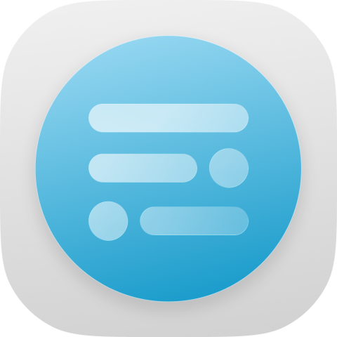

<p align="center">
  
</p>

<h1 align="center"><strong>HyperChanger</strong></h1>

<p align="center">HyperOS 4 を、あなた好みに。</p>

<p align="center">
  <a href="README.md">简体中文</a> |
  <a href="README_en.md">English</a> |
  <strong>日本語</strong>
</p>

<p align="center">
  <a href="https://github.com/ColdP/HyperChanger/releases">リリース</a> |
  <a href="https://t.me/HyperChanger">Telegram グループ</a> |
  <a href="https://qm.qq.com/q/rQhbQbiYLe">QQ グループ：429188055</a>
</p>

<p align="center">
  
  
  
  
  
</p>

## 概要

HyperChanger は、Xiaomi HyperOS 4 向けのモダンな Xposed モジュールです。付属の設定アプリから、システム UI、通知とコントロールセンター、ロック画面、ランチャー、システム設定、背面ディスプレイ、対応アプリの外観や動作を変更できます。Root 権限が必要で、既存のコンポーネントをフックして変更します。

ソースコードのバージョンは [app/build.gradle.kts](app/build.gradle.kts) の `versionName` を基準とし、README ではバージョン文字列を重複管理しません。ダウンロードと更新内容は [Releases](https://github.com/ColdP/HyperChanger/releases) を参照してください。

今回の正式版の変更内容は [1.2.2 リリースノート](RELEASE_NOTES_1.2.2.md)（簡体字中国語）を参照してください。

本プロジェクトはテスト段階にあり、主な対応環境は **HyperOS 4（Android 17）** です。端末、地域、システムビルド、アプリのバージョンによって動作が異なります。インストール可能な最小バージョンを満たしていても、すべての機能が利用できるとは限りません。

## 機能

### 通知、コントロールセンター、音量パネル

- 通知センターとコントロールセンターの背景を個別に設定し、通常通知、メディア通知、フォーカス通知などのマテリアル、ぼかし、不透明度、角の丸みを調整できます。
- iOS 風通知センター：角丸の壁紙パネル、ロック画面の時計、深度効果に対応。ロック画面の壁紙の表示切り替え、クリアボタンの非表示、通知下端のオフセット調整が可能です。ライブ壁紙には現在対応していません。
- iOS 風通知センターの動作性能を改善し、展開・折りたたみ・ジェスチャー操作時のカクつきを軽減します。コントロールセンターとの切り替え時の壁紙ぼかしも滑らかにしています。
- ヘッダーのアイコン、文字、倍率、間隔と、クリアボタンのスタイルやマテリアルを変更できます。ロック画面の左右ショートカットを通知センターに追加し、元の操作とドラッグジェスチャーを利用できます。このモードの通知下端オフセットは個別に保存されます。
- コントロールセンターの大きな時計、日付との間隔、赤色の「1」、通信事業者名、ネットワーク表示、ヘッダーの高さを変更できます。
- 「ステータスバーとコントロールセンター → コントロールセンター上部ボタン」でアイコン倍率、横画面での表示、背景を調整できます。単色、高度なマテリアル、ソフトガラスに対応し、ソフトガラスは個別設定またはグローバル設定を使用できます。
- WLAN、モバイルデータ、メディア、明るさ、音量タイルの配置を変更できます。小タイルの自動補充、メディアソースアイコンの非表示、配置のリセットにも対応しています。
- タイル一覧から上部パネルの項目を選び、サイズを記憶できます。編集画面ではシステム風アイコンと再生中メディアのカバー・タイトルを確認できます。上部ボタンを下部に移動し、上下それぞれのアイコン倍率、角丸、間隔を保存できます。
- 音量パネルのぼかし、ガラス効果の強さ、背景の不透明度、角の丸み、音量スライダーの幅と高さを調整できます。
- 内蔵プリセットやユーザープリセットを利用し、通知とコントロールセンターの設定を JSON または QR コードで共有できます。

### スーパーアイランド、ステータスバー、ジェスチャーバー

- スーパーアイランドの幅、大小アイランド間の距離、折りたたみ時の輪郭の滑らかさ、背景マテリアルを調整できます。
- 展開されたスーパーアイランドのソフトガラスパラメータを個別に調整し、グローバル設定に追従させることもできます。
- フォーカス通知とスーパーアイランドの一部ホワイトリスト制限を解除し、通知背景やメディアカードを変更できます。通常通知、フォーカス通知、メディア通知のシミュレーションも利用できます。
- ステータスバーの2段式電波表示、ネットワーク種別の文字、アイコンの表示、倍率、位置、間隔を変更できます。
- システム全体のジェスチャーバーのスタイルとサイズを調整できます。

### ロック画面、音楽、壁紙

- ロック画面の時計と水平位置、深度効果、充電テキスト、下部ショートカット、指紋アイコン、PIN 入力画面の外観を変更できます。
- ロック画面編集ページの背景、テンプレート数の上限、ロック画面カプセル、顔認証アイランドを設定できます。高徳地図（AMap）のナビゲーションとカプセルの連携にも対応しています。
- ロック画面ウィジェットに天気、バッテリー、日の出・日の入り、歩数、アラーム、予定、署名画像を組み合わせ、並べ替えやレイアウト、色、マテリアルの調整ができます。
- 音楽カバーを使ったロック画面、ミニプレーヤー、歌詞表示を利用できます。歌詞ライブラリでローカルの歌詞を管理できます。
- ラスター効果のライブ壁紙を設定し、現在のホーム画面とロック画面の壁紙を書き出せます。
- HyperChanger の深度壁紙パックを読み込み、管理、プレビュー、有効化できます。
- グローバルテーマ適用後もソフトガラス効果を保持し、AOD 時計のガラス・重ね合わせマテリアルに対する OTA 変換制限を解除できます。

### ランチャーと最近使ったアプリ

- 対応する HyperOS 4 の Rust ランチャーに Dock を追加できます。単色、高度なマテリアル、ソフトガラスの背景と表示アニメーションに対応しています。
- Dock の高さ、左右と下部の余白、角の丸み、色、不透明度、ぼかしを調整できます。
- ランチャーと Dock のガラスぼかし・光学パラメータを個別に調整するか、グローバル設定に連動できます。Dock はシステム既定値も選択できます。フォルダーと最近使ったアプリには個別のマテリアル設定があり、フォルダーの列数、アイコンの行間隔、Dock アイコンの上下位置も変更できます。
- 最近使ったアプリのクリアボタンを非表示にし、ボタンの機能を残すか無効にするかを選べます。
- Dock にはシステムフレームワークとランチャーの両スコープが必要です。初回利用時は端末を手動で再起動してください。

### システム設定と背面ディスプレイ

- システム設定のホームページと端末情報ページで、背景、端末カード、ロゴ、端末画像、表示される仕様を変更し、モジュールへのショートカットを追加できます。
- ローカルとクラウドの端末情報プリセットを参照し、プレビュー、ダウンロード、適用ができます。
- システム設定の項目名、アイコン、モジュール項目、効果音バッジをカスタマイズし、ホーム画面のアイコンと文字の拡大率、行間を調整できます。自動ロックとリフレッシュレートの選択肢を増やし、Google サービス項目や保存済み Wi-Fi パスワードを表示できます。
- 対応端末で BOSE チューニングを開放し、効果音バッジを変更できます。既存のシステム設定を利用するもので、音質の向上を保証する機能ではありません。
- 背面ディスプレイの一部 AI 機能を解除し、インポートしたアプリの管理や音楽ウィジェットで使用するアプリの選択ができます。
- 背面ディスプレイの右端から左へスワイプして選択したアプリを起動できます。すべての Activity を背面ディスプレイで開く設定もありますが、アプリ自体の対応が必要な場合があります。
- 背面ディスプレイの壁紙数の上限を変更し、テーマ変更と背面ディスプレイのテーマ・壁紙の認証処理との競合を修正できます。これらの設定にはテーマのスコープが必要です。
- 背面ディスプレイ 1 で NetEase Cloud Music の標準ミニプレーヤーを起動できます（対応基準 9.5.37）。NetEase Cloud Music と背面ディスプレイの両スコープを選択し、端末のロックを解除して使用してください。
- スクリーンショットアプリの背面画面シェルをフォーカス版・全体版でカスタマイズできます。画像や ZIP の読み込み、プレビュー、名前を付けて保存、適用、PNG 画像の書き出しに対応しています。

### カメラ、ギャラリー、スーパー XiaoAi と入力方式

- 対応カメラで Leica LCC UI、標準の焦点距離の保持、「一瞬」モードを設定できます。
- ギャラリー編集の一部ウォーターマークや Xiaomi 18 シリーズの編集機能を解除できます。利用可否はギャラリーとメディアエディターのバージョンに依存します。
- スーパー XiaoAi のフローティング入力欄にソフトガラス効果を追加し、マテリアルのパラメータを個別に調整できます。
- スーパー XiaoAi 入力方式の一部ブラックリスト、クリップボード、AI、音声の安全制限を解除できます。
- キーボードのガラス効果、色、角の丸み、不透明度、ぼかしを調整できます。

### ダイヤル、コンテンツ拡張、環境検出

- ダイヤルパッド背景のぼかし、不透明度、枠線の幅と不透明度、角の丸みのオフセットを変更できます。「ダイヤルと通話」のスコープが必要です。
- コンテンツ拡張（Portal）の背景マテリアル、角の丸み、展開時の高さ、フローティング表示とアイコンのサイズを調整できます。全画面の半透明オーバーレイの除去や開発者モードの常時有効化にも対応し、ソフトガラスは個別またはグローバルのパラメータを使用できます。
- Portal の中国語・日本語・英語の文字認識を強化し、ローカル OCR モデルをアプリ内でダウンロード、管理、削除できます。強化機能を使う前にモデルをダウンロードしてください。
- 「その他 → 環境検出」には、実験的なマスタースイッチと Xiaomi Trust Service・セキュリティの検出に関する個別設定があります。既定では無効で、有効にすると個別設定が表示されます。初回有効化の前に画面の案内を順に確認してください。対応するスコープが必要で、すべてのアプリの環境検出結果が変わることを保証するものではありません。
- 実験的なプリインストールアプリのプライバシー保護では、System Helper とシステムのセキュリティコンポーネントを対象に、送信先、アプリ一覧・使用統計、端末・SIM 識別子、画面・音声キャプチャを個別に制限できます。既定では無効で、初回利用時は画面の案内を確認してください。

### サイドバー、App Vault、システムアプリ

- サイドバーのソフトガラスを個別設定またはグローバル設定で調整し、カードのマテリアルを統一できます。動画ツールボックスの温度制限も調整できます。
- アプリアイコンの2列表示、表示数、列間隔、カードの角丸、パネルの幅と高さ、アイコン倍率を変更し、全アプリ展開ボタンをカプセル形状にできます。2列表示の展開アニメーションも改善しています。
- App Vault の背景を標準、ホーム画面の壁紙、カスタム画像から選び、壁紙のぼかしを解除・調整できます。ウィジェットのソフトガラスも個別に設定できます。
- バッテリー温度、健康度、追加情報、完全な消費統計を表示できます。対応端末では、ワイヤレス充電、低温時の持続時間、その他の充電オプションを開放できます。
- Joyose を通じてゲームの GPU 設定を開放できます。
- 「その他 → クラウド制御」には既定で無効の実験的なマスタースイッチがあり、HTML ビューアーと Joyose のクラウドタスク同期を個別に遮断できます。初回利用時は画面の案内を確認してください。

### アプリの下部ナビゲーション

- QQ、Apple Music、Weibo、小紅書、Xiaomi ショップ、Mi Wallet、Mi Fitness、Luckin Coffee、Tencent Meeting、抖省省、美団、美団外売、招商銀行、WeChat、Pinduoduo、Instagram、Pinterest、Reddit、X、GitHub に対応しています。アプリごとにスタイル、ラベル、色を選択でき、未読表示などの設定は各アプリの対応状況によって異なります。
- 液体ガラス、HyperOS の画面下端固定型、HyperOS のフローティング型、HarmonyOS のフローティング型から選べます。HyperOS の下端固定型に液体ガラスを適用する機能は、既定で無効の実験的な設定です。確認後、モジュールと対象アプリに適用されます。
- 3 種類のフローティング型では、アプリごとに幅と高さを個別調整（-100.00%～100.00%、0.01% 単位）し、上下位置と角丸（-96～0）を変更できます。0 は標準のカプセル形状、-96 は直角です。背景と既存の選択カプセルの角丸を同じ割合で変更し、下端固定型では倍率と角丸の設定を非表示にします。
- ぼかし、不透明度、屈折、ハイライト、色分散などのマテリアルをグローバル設定またはアプリ別に調整し、プレビューできます。モジュールのナビゲーションにグローバル設定を適用することもできます。上下位置は全体設定とアプリ別の上書きに対応し、小紅書の独立投稿ボタン、WeChat のアバター角丸、Mi Wallet のタブ選択なども設定できます。
- メイン一覧にはインストール済みアプリとバージョン名を表示します。未インストールのアプリは別の表示専用ページで、アプリ名とパッケージ名のみを表示します。
- 指定アプリのナビゲーション適用を無効にし、専用一覧から再び有効にできます。Reddit の独立作成ボタン、Reddit と Pinduoduo のナビゲーションバーのスライド表示・非表示にも対応しています。
- 対応分析の基準には招商銀行 14.4.6、美団 12.68.202、美団外売 8.85.1 などを使用しています。アプリ更新後は再検証が必要で、ビルド成功はすべての画面での実機動作を保証しません。

### その他のアプリとシステム更新

- Mi Fitness のウォッチフェイスの10分間試用制限を解除できます。
- MiShare の AirDrop 利用可否チェックを上書きできます。実際の転送にはシステムコンポーネント、ハードウェア、相手端末の対応が必要です。
- 画面録画のフレームレートとビットレートの選択肢を追加し、保存先を変更できます。
- クイックスクリーンショットと任意画面のスクリーンショット設定を追加できます。
- システムフレームワークで、複数・強制フリーフォームウィンドウ、位置と状態の記憶、画面端に寄せた小窓のバックグラウンド動作、音量の即時変更、高音量警告の解除、強制ダークモード、標準インストーラー、72時間ごとのパスワード入力の無効化などを設定できます。
- システム更新の無効化、一部 OTA 制限の解除、表示上のシステムおよび SOTA バージョンの変更ができます。

### モジュールアプリ、言語、更新

- MIUIX ベースの設定画面で、ライト・ダーク・システム連動テーマ、複数の下部ナビゲーション、予測型「戻る」アニメーションに対応しています。Monet の配色を有効にし、システム配色、10 種類の内蔵テーマ、カスタム色から選べます。
- フローティングガラスの検索ボタンから、設定名、説明、キーワード、アプリのパッケージ名で検索し、該当ページへ直接移動できます。モジュール自体の設定を検索結果に含めるかも選択できます。
- 簡体字中国語、英語、日本語を内蔵し、言語パックのインポート、エクスポート、編集ができます。
- モジュール設定を JSON または対応リソースを含む ZIP で入出力し、読み込み前に設定とリソースを確認できます。スコープ対象アプリの再起動も管理できます。
- GitHub または Gitee からモジュールの更新を確認・ダウンロードし、手動または Root によるサイレントインストールができます。
- モジュール全体のスイッチ、機能ごとの安全無効化、ログレベル・フィルター・保持期間・ZIP 出力を利用できます。
- 「設定 → モジュールの安全性」で実行中の対象プロセスを一覧表示し、手動のホットリロード要求とプロセスごとの結果確認ができます。モジュール側の対応は未完成のため、必要な再起動をこの機能で置き換えることはできません。
- ログ ZIP には `environment.txt` が含まれ、端末、システム、モジュール、フレームワークの情報と、現在選択されているスコープのアプリのバージョンを確認できます。

## 互換性と動作要件

| 項目 | 詳細 |
| --- | --- |
| 主な対応環境 | Xiaomi HyperOS 4（Android 17） |
| インストール可能な最小バージョン | Android 15（API 35）；全機能の互換性を保証するものではありません |
| コンパイル / ターゲット SDK | API 37 |
| モジュールフレームワーク | Root と、モダンな libxposed API に対応する Vector / LSPosed；最小 API 102、ターゲット API 102 |
| ネイティブライブラリのアーキテクチャ | ビルド対象は `arm64-v8a` のみ。ビルド済みの `libhyperpatch.so` は `jniLibs` に配置し、Dock とフォルダーパッチは `src/main/cpp` からビルドします |
| オプションのコンポーネント | 各機能には、対応バージョンの対象アプリまたはシステムコンポーネントが必要です |

アプリは `ro.mi.os.version.code` を確認します。HyperOS が検出されない場合は終了し、HyperOS 4 以外では警告を表示します。この確認を通過しても、現在のシステムですべてのフックが動作するとは限りません。

フレームワーク対応は [Vector canary-3114](https://github.com/JingMatrix/Vector/releases/tag/canary-3114)（API 102）の公開ソースを基にしています。ホーム、モジュールの安全性、ログの環境情報には接続中のフレームワーク名とバージョンを表示し、カードをタップすると対応するマネージャーを開きます。旧ビルドの互換性は API 実装に依存します。Vector の実機検証は未実施です。

フレームワークの識別情報は接続中の libxposed サービスから取得します。マネージャーのインストールや Root モジュールの有効化だけでは、HyperChanger が接続済みであることにはなりません。ホームのカードまたはモジュールの安全性のフレームワーク情報をタップすると、対応する単独版または寄生マネージャーを開きます。未接続時は有効なフレームワークを調べ、寄生マネージャーを特定できなければ単独版だけを試します。

## モジュールのスコープ

Vector / LSPosed でモジュールを有効にし、使用する機能に必要なスコープを選択してください。以下は [scope.list](app/src/main/resources/META-INF/xposed/scope.list) に対応する一覧です。

| スコープ | パッケージ名 / 識別子 |
| --- | --- |
| システム UI | `com.android.systemui` |
| システムフレームワーク | `system` |
| システムランチャー | `com.miui.home` |
| 壁紙 | `com.miui.miwallpaper` |
| システム UI プラグイン | `miui.systemui.plugin` |
| 常時表示（AOD） | `com.miui.aod` |
| Xiaomi カメラ | `com.android.camera` |
| Xiaomi ギャラリー | `com.miui.gallery` |
| Hyper ギャラリープラグイン | `com.hyper.gallery.plugin` |
| メディアエディター | `com.miui.mediaeditor` |
| 画面録画 | `com.miui.screenrecorder` |
| スクリーンショット | `com.miui.screenshot` |
| スーパー XiaoAi 入力方式 | `com.xiaomi.type` |
| XiaoAi フレーズ | `com.miui.phrase` |
| システム設定 | `com.android.settings` |
| システム更新 | `com.android.updater` |
| 背面ディスプレイセンター | `com.xiaomi.subscreencenter` |
| パーソナルアシスタント | `com.miui.personalassistant` |
| テーマ | `com.android.thememanager` |
| Xiaomi ショップ | `com.xiaomi.shop` |
| Mi Wallet | `com.mipay.wallet` |
| Mi Fitness | `com.mi.health` |
| Apple Music | `com.apple.android.music` |
| NetEase Cloud Music | `com.netease.cloudmusic` |
| Weibo | `com.sina.weibo` |
| 小紅書 | `com.xingin.xhs` |
| Luckin Coffee | `com.lucky.luckyclient` |
| 高徳地図（AMap） | `com.autonavi.minimap` |
| MiShare | `com.miui.mishare.connectivity` |
| Xiaomi 連携サービス | `com.xiaomi.xmsf` |
| XiaoAi 音声 | `com.miui.voiceassist` |
| Xiaomi サウンド | `com.miui.misound` |
| Xiaomi 設定 | `com.xiaomi.misettings` |
| Tencent Meeting | `com.tencent.wemeet.app` |
| 抖省省 | `com.ss.android.ugc.lifeservices` |
| 美団 | `com.sankuai.meituan` |
| 美団外売 | `com.sankuai.meituan.takeoutnew` |
| 招商銀行 | `cmb.pb` |
| WeChat | `com.tencent.mm` |
| QQ | `com.tencent.mobileqq` |
| Pinduoduo | `com.xunmeng.pinduoduo` |
| Xiaomi Trust Service | `com.xiaomi.trustservice` |
| セキュリティ | `com.miui.securitycenter` |
| Instagram | `com.instagram.android` |
| Pinterest | `com.pinterest` |
| Reddit | `com.reddit.frontpage` |
| ダイヤルと通話 | `com.android.contacts` |
| コンテンツ拡張（Portal） | `com.miui.contentextension` |
| X | `com.twitter.android` |
| GitHub | `com.github.android` |
| HTML ビューアー | `com.android.htmlviewer` |
| Joyose | `com.xiaomi.joyose` |
| システムヘルパー | `com.mobiletools.systemhelper` |
| システムセキュリティコンポーネント | `com.miui.guardprovider` |

端末によっては存在しないパッケージもあります。実際に使用するスコープだけを選択してください。スコープの宣言は、対象アプリのすべてのバージョンへの対応を保証するものではありません。

## インストールと使い方

1. [Releases](https://github.com/ColdP/HyperChanger/releases) から署名済み APK をダウンロードし、インストールします。
2. Vector / LSPosed で HyperChanger を有効にし、必要なスコープを選択します。
3. 設定アプリを開き、環境チェックを完了して、初回利用時の説明と規約を確認します。
4. 必要な機能を有効にします。アプリの案内に従い、スコープ対象アプリの再起動機能を手動で操作して設定を反映します。
5. 初めて Dock を有効にする場合は、システムフレームワークとランチャーのスコープを確認し、端末を手動で再起動します。

「設定 → モジュールの安全性」の「プロセスのホットリロード」は既定で有効で、手動要求の入口を制御します。要求には、libxposed API 102 以降と該当機能に対応したフレームワークへの接続が必要です。現在のモジュールエントリーにはリロードの許可と Hook の再構築を行うコールバックがなく、モジュール側の対応は未完成です。従来の案内に従って対象アプリや端末を再起動してください。非対応、失敗、タイムアウト時はプロセスごとの結果を確認し、タイムアウト後の重複送信を避けてください。

## プリセットと言語パック

- **通知とコントロールセンターのプリセット**：内蔵・ユーザープリセットに対応しています。長押しで JSON または QR コードを書き出し、ファイルまたは QR コード画像から読み込めます。
- **ソフトガラスのプリセット**：内蔵・カスタムのパラメータプリセットを利用し、JSON や QR コードで共有できます。グローバル設定に追従する表示面は、対応するグローバルのソフトガラスパラメータを使用します。
- **モジュール設定プリセット**：「設定」で設定のみ（JSON）、または設定とリソース（ZIP）を書き出せます。ZIP には対応する設定画面の外観素材、アイコン、歌詞、スクリーンショットシェル、ロック画面素材、App Vault 背景、ナビゲーションのマテリアルプレビュー画像などを含めます。JSON にはファイル本体を含めません。読み込み前に設定グループとリソースを確認し、上書きを承認します。外部画像の参照や深度壁紙パックなどは対象外のため、別途移行してください。古いプリセットにないアプリナビゲーション設定は現在の値を維持します。
- **言語パック**：中国語、英語、日本語、システム言語に連動する設定を選べます。[languages/example.json](languages/example.json) を参考に作成し、アプリ内でインポート、編集、エクスポートできます。

プリセットの種類に合った読み込み画面を使用してください。読み込み後は設定を確認し、再起動が必要な項目は案内に従って反映してください。

## トラブルシューティング

| 症状 | 対処方法 |
| --- | --- |
| 設定が反映されない | 機能のスイッチ、Vector / LSPosed のスコープ、対象アプリのバージョンを確認し、案内に従って対象アプリを手動で再起動してください。 |
| Dock が表示されない | システムフレームワークとランチャーのスコープ、Rust ランチャーの互換性、初回有効化後の端末の手動再起動を確認してください。 |
| iOS 風通知センターに壁紙が表示されない | 壁紙の表示設定を確認してください。ライブ壁紙には現在対応していません。 |
| フレームワークが未接続・マネージャーが開かない | Vector / LSPosed が実行中で HyperChanger が有効であることを確認してください。未接続時の寄生マネージャーの識別には Root が必要な場合があります。識別できない場合は通知や既存のショートカットから開いてください。 |
| ホットリロードが利用できない・成功しない | モジュール側の対応は未完成です。フレームワークの接続、API 102 の機能、対象プロセスと結果を確認し、従来の再起動案内に従ってください。タイムアウト後は重複送信を避けてください。 |
| システム UI が繰り返しクラッシュする | Vector / LSPosed または Recovery からモジュールを無効にし、復旧後に設定や他のモジュールとの競合を一つずつ確認してください。 |
| 特定の機能が利用できない | システムやアプリの実装が非対応の可能性があります。端末、システム、対象アプリのバージョンを添えて報告してください。 |
| プリセットを読み込めない | プリセットの種類、読み込み画面、書き出したバージョンが一致し、ファイルや QR コードが破損していないか確認してください。 |

Issue には、端末モデル、Android / HyperOS のバージョン、モジュールと Vector / LSPosed のバージョン、対象アプリのバージョン、スコープ、再現手順を添えてください。「設定 → モジュールの安全性」からログ ZIP を書き出し、関連 Logcat ログも添付できます。共有前にログと環境情報を確認し、個人情報を除去してください。

## ソースコードからのビルド

必要な環境は、JDK 21（CI と同じ）、Android SDK 37、NDK r30（30.0.16248370）、CMake 3.22.1、および Android Gradle Plugin 9.2.1 に対応する Android Studio またはプロジェクトの Gradle Wrapper（9.6.1）です。[app/build.gradle.kts](app/build.gradle.kts) の NDK パスはリポジトリ内の `.build-tmp/android-ndk-r30` に固定されています。そこに NDK を配置するか、インストール済み NDK へのディレクトリリンクを作成してください。[CI 設定](.github/workflows/android.yml) も参照できます。

```bash
git clone https://github.com/ColdP/HyperChanger.git
cd HyperChanger
./gradlew :app:assembleDebug
```

Windows PowerShell：

```powershell
.\gradlew.bat :app:assembleDebug
```

Debug APK の出力先：`app/build/outputs/apk/debug/app-debug.apk`。

`docs/`、`tests/`、逆解析の生成物はローカルの保守資料で、Git の対象外となり、リポジトリには含まれません。APK ビルドで確認できるのはコンパイルとパッケージ化です。システムフック、GPU マテリアル、対象アプリの操作は、対応する端末とバージョンで検証する必要があります。

Release の署名は Gradle プロパティ `releaseStoreFile`、`releaseStorePassword`、`releaseKeyAlias`、`releaseKeyPassword` で設定し、キーストアはリポジトリ外に保管してください。署名済みビルドは `app/build/outputs/apk/release/` に出力されます。公開するファイル名は `HyperChanger-v<VersionName>.apk` とし、バージョン内の空白をハイフンに置き換えます（例：`HyperChanger-v1.2.2.apk`）。キーストア、パスワード、ビルド生成物をコミットしないでください。

## ディレクトリ構成

```text
HyperChanger/
|-- app/
|   |-- src/main/java/       Kotlin / Java のモジュールと UI のソース
|   |-- src/main/assets/     言語パック、アプリナビゲーション素材、法的文書、第三者の権利表記
|   |-- src/main/cpp/        Dock・フォルダーなどの ARM64 ネイティブパッチのソース
|   |-- src/main/jniLibs/    ビルド済み ARM64 libhyperpatch.so
|   |-- src/main/res/        Android リソース
|   `-- src/main/resources/  libxposed エントリー、メタデータ、スコープ
|-- languages/example.json   言語パックのテンプレート
|-- gradle/                  Gradle Wrapper
|-- README.md                中国語のメイン README
|-- README_en.md             英語版
|-- README_ja.md             日本語版
|-- CONTRIBUTING_zh.md
|-- NOTICE
`-- LICENSE
```

## 貢献

不具合報告や改善を歓迎します。参加する前に [英語の貢献ガイド](CONTRIBUTING.md) または [中国語の貢献ガイド](CONTRIBUTING_zh.md) をお読みください。

## 免責事項

HyperChanger はコミュニティが開発する実験的なモジュールであり、Xiaomi との提携関係や公式の許諾はありません。システムへのフックにより、表示の異常、アプリのクラッシュ、起動不能が発生する可能性があります。互換性はシステムやアプリの更新によって変化します。テスト前に重要なデータをバックアップし、Vector / LSPosed または Recovery でモジュールを無効にできる手段を確保してください。利用は自己責任であり、特定の端末や将来のバージョンへの対応は保証しません。

## ライセンスと謝辞

この結合した配布物は [GNU AGPL 第3版](LICENSE) に基づき提供されます。HyperChanger の独自ファイルは AGPL-3.0-or-later、新しい HyperMusicCover は AGPL-3.0-only のため、結合した配布物には第3版を適用します。過去の許諾、第三者の権利表記と変更記録は [NOTICE](NOTICE) を参照してください。

- 音楽ロック画面、歌詞、ロック画面カプセルは [HyperMusicCover](https://github.com/zyl6932/HyperMusicCover) の 2026-10-30 ソーススナップショット（AGPL-3.0-only、一部 Apache-2.0 / GPL-3.0）から導入・改変しています。既存の通知センターは元の Apache-2.0 許諾を維持します。ライセンスと変更内容は [NOTICE](NOTICE) を参照してください。
- 折りたたみ時のアイランドの輪郭、大小アイランド間の距離、顔認証アイランドの実装は [HyperIsland 3.1.8](https://github.com/1812z/HyperIsland)（Copyright 2026 1812z、MIT）を基にしています。全文は [HyperIsland-MIT.txt](app/src/main/assets/licenses/HyperIsland-MIT.txt) を参照してください。
- 省電力とバッテリー、動画ツールボックスの温度制限解除に関するコードは [HyperCeiler](https://github.com/ReChronoRain/HyperCeiler)（複数のバージョン · AGPL-3.0 / MIT、Copyright 2023–2026 HyperCeiler Contributions）を参考に移植・調整しています。各ファイルにはそれぞれのライセンスが適用され、今回移植したバッテリーと動画ツールボックスの元ファイルは AGPL-3.0-or-later です。[NOTICE](NOTICE) と上流の MIT 表記 [HyperCeiler-MIT.txt](app/src/main/assets/licenses/HyperCeiler-MIT.txt) を参照してください。
- モジュールの設定画面は [MIUIX 0.9.4](https://github.com/compose-miuix-ui/miuix)（Apache-2.0）を基盤に、HyperOS スタイルの UI コンポーネント、設定項目、アイコン、ぼかし効果（`miuix-ui`、`miuix-preference`、`miuix-icons`、`miuix-blur`）を使用しています。画面の基盤を提供する MIUIX の作者と貢献者に感謝します。[公式ドキュメント](https://compose-miuix-ui.github.io/miuix/) と [NOTICE](NOTICE) を参照してください。
- AndroidLiquidGlass / Backdrop、および各依存プロジェクトに感謝します。詳細はアプリ内のオープンソース表記を参照してください。

## Star History

<a href="https://www.star-history.com/?repos=ColdP%2FHyperChanger&type=date">
  <picture>
    <source media="(prefers-color-scheme: dark)" srcset="https://api.star-history.com/chart?repos=ColdP/HyperChanger&type=date&theme=dark" />
    <source media="(prefers-color-scheme: light)" srcset="https://api.star-history.com/chart?repos=ColdP/HyperChanger&type=date" />
    
  </picture>
</a>
